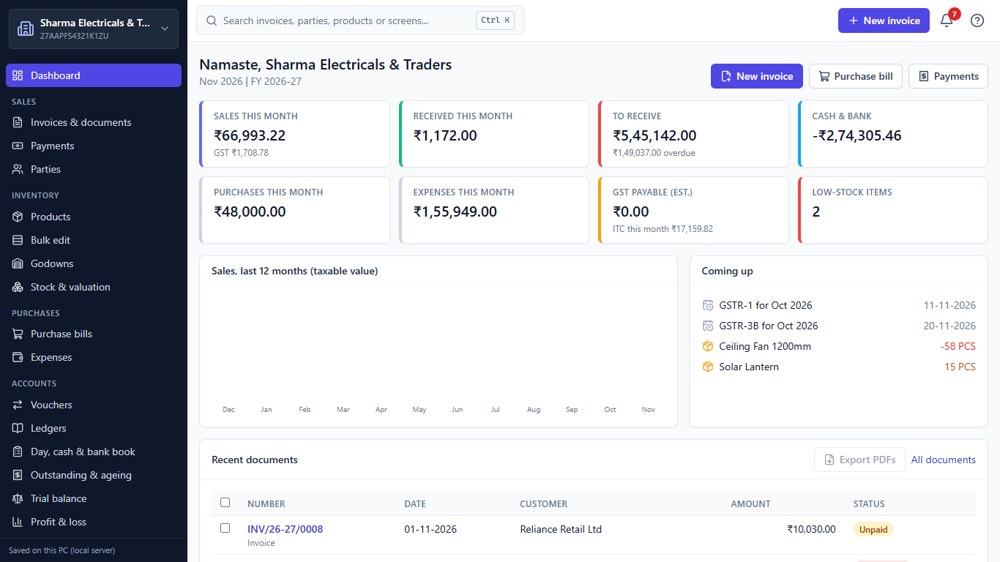

# Design critique: Free GST Billing (release candidate)

Date: 7 November 2026. Method: the Kiro Crew design-critique procedure (heuristic review of the running app, NN/g severity, skeptic pass). This is an expert review, not user research and not an accessibility audit. Screenshots are in [design-shots/](design-shots/). The brief, the setup and the assumptions are at the end.

## Overall read

The app is calm, readable and quick at its core job, but the PDF that customers receive has QR codes and a barcode that cannot be scanned, and dates and money read differently from screen to screen. Fix those before release.

**Health: promising, needs work. 0 catastrophes, 7 major, 16 minor, 6 cosmetic (29 findings).**

## What's working

- **The payment loop is fast.** Finalize opens the invoice page in 430 ms with "Record payment" as the primary button. The payment dialog fills in the balance (₹6,358.00), picks UPI and the default bank account and puts the cursor in Amount, so recording a full payment takes one press of Save. A toast confirms each step ("Invoice INV/26-27/0009 saved", "Receipt RCT/26-27/0004 saved") and the status chip changes to Paid. ([f4-finalized.png](design-shots/f4-finalized.png), [f6-paid.png](design-shots/f6-paid.png), [d-payment-dialog.png](design-shots/d-payment-dialog.png))
- **On screen and in print, the paper looks like a real Indian GST invoice.** Tally, Modern and Thermal all carry the HSN summary, the amount and tax in words, bank details and a UPI "Scan to pay" QR, and the editor's live preview updates as you type. ([p-tally.png](design-shots/p-tally.png), [p-modern.png](design-shots/p-modern.png), [p-thermal.png](design-shots/p-thermal.png))
- **The basics are solid.** Every interface text I measured passes WCAG AA contrast (the lowest is 4.55:1, #64748b on #f8fafc). The focus ring is a 2 px #6366f1 outline (4.47:1 on white), every control has an accessible name, and Ctrl+K search groups documents, parties and vouchers ([d-palette-results.png](design-shots/d-palette-results.png)). Warnings use plain words and don't block, for example "Ceiling Fan 1200mm: -58 in stock. You can still save; stock will go negative."

## The flow: new invoice → finalize → record payment → print / PDF

| Step | What it asks | What reads as primary | Between this step and the next |
|---|---|---|---|
| 1. New invoice (header button or Alt+N) | Pick a customer and the items | Finalize, top right | Red errors are already showing before anything is typed (F02), and Items start below the first screen (F19) |
| 2. Finalize | Nothing more: the number is assigned | n/a | 430 ms to the invoice page, with a toast and the new number INV/26-27/0009. Clear closure. |
| 3. Record payment | Confirm the amount and mode | Save | The dialog closes and the chip turns Paid. "Print the receipt after saving" is ticked by default, so the print dialog is called straight after Save (window.print was called once). |
| 4. Print or PDF | Send the invoice | No single primary; Print, PDF and Share are equal | Print opens the browser's print dialog. PDF downloads "Invoice INV-26-27-0009 Anita Desai.pdf", but its codes are broken (F01). |

There is a forward path at every step and the end state says what happened, so the problems are in the details.

### F01 · Major · Step 4, PDF: the QR codes and barcode in the PDF are broken

- **Evidence:** In the downloaded PDF (Tally design), the UPI "Scan to pay" QR is a single black corner block with one dot, the "Invoice QR" is a black L, and the barcode is a few thick bars. A second PDF (INV/26-27/0002 in the Modern design) shows the same block. The on-screen preview and the print preview draw all three codes correctly.
- **Measured:** The three codes are SVG data-URL images. Their natural size is the browser default (150×150 for the QRs, 300×150 for the barcode), while they are displayed at 74×74, 58×58 and 231×28 px. The likely cause is that the PDF renderer draws them at the default size and crops them. That is an inference: I did not trace it in the code.
- **Who it hurts:** Every customer who gets the invoice as a PDF on WhatsApp or e-mail and tries to scan to pay. It also hurts the shop owner, who sees a correct QR on screen and has no way to know the PDF is broken.
- **Fix:** One option is to give the SVG images an explicit width and height, or turn them into PNGs at print size, before the PDF snapshot runs. A test that decodes the QR from a generated PDF page would stop this from coming back.
- **Shots:** [f8-pdf-crop-qr.png](design-shots/f8-pdf-crop-qr.png), [f8-pdf-crop-barcode.png](design-shots/f8-pdf-crop-barcode.png), [f8-pdf-page-1-half.jpg](design-shots/f8-pdf-page-1-half.jpg), [m8-modern-pdf-crop.png](design-shots/m8-modern-pdf-crop.png). For comparison, the correct on-screen version is [p-tally.png](design-shots/p-tally.png).

### F02 · Major · Step 1, invoice editor: errors show before the user does anything, and one of them is false

- **Evidence:** A blank new invoice opens with red borders on Customer and Item 1, and a red "Needed before finalizing" box that lists four errors. After a customer and two items are filled in, the box still says "Document number is required". Yet the Number field's own hint says "Given automatically when you finalize", and Finalize worked without a number. Pressing Finalize on the blank invoice gives a toast that lists only the three real errors and leaves out the number.
- **Measured:** Both fields have border rgb(248, 113, 113) at first load, and neither has aria-invalid. The box sits 2,259 px down the content pane, while Finalize is at the top (y 73).
- **Who it hurts:** Every invoice. A user who trusts the box may type an invoice number by hand and break the automatic consecutive series. The red box also teaches people to ignore red.
- **Fix:** Consider showing field errors only after the first Finalize attempt or after the user leaves a field. Drop the number check from the box, because the number is assigned automatically, and put the summary next to Finalize (or scroll to the first bad field). Fields that show red should also get aria-invalid.
- **Shots:** [d-invoice-new.png](design-shots/d-invoice-new.png), [f3-filled-full.jpg](design-shots/f3-filled-full.jpg) (bottom: the number error is still there when everything is filled), [d-finalize-empty.png](design-shots/d-finalize-empty.png)

### F03 · Minor · Steps 3 → 4, invoice page: the header buttons jump after payment

- **Evidence:** Before payment the header row is Saved design · Print · PDF · Share · Edit · Record payment. After Save, "Record payment" disappears and every other control slides right. Print moves from x 859 to x 1019.
- **Measured:** 160 px shift for all five persistent controls, read from the two 1:1 screenshots.
- **Who it hurts:** Users who print or share right after recording the payment, which is the natural next step. Their pointer lands on the wrong control.
- **Fix:** Consider keeping the slot: show a "Paid" state of the same width where "Record payment" was, or put "Record payment" at the left end so the stable buttons don't move.
- **Shots:** [f4-finalized.png](design-shots/f4-finalized.png) → [f6-paid.png](design-shots/f6-paid.png)

### F04 · Minor · Steps 1 → 4: "Amount" means two different things

- **Evidence:** In the editor, LED Bulb 9W, 10 at ₹99, shows "Amount ₹1,168.20", which includes 18% GST. The live preview beside it and the final invoice show "Amount 990.00" for the same line.
- **Who it hurts:** Anyone checking a line against the printed invoice, or answering a customer's question about it.
- **Fix:** Consider labelling the editor figure "Line total (incl. GST)", or showing "₹990.00 + ₹178.20 GST" so it matches the paper.
- **Shots:** [f3-filled.png](design-shots/f3-filled.png)

## Findings by screen

### Across screens

#### F05 · Major · Dates appear in four formats, and date inputs read month-first

- **Evidence:** Every date input shows MM/DD/YYYY in this browser, while the rest of the app writes DD-MM-YYYY:
  - The voucher listed as 04-11-2026 opens in its editor as "11/04/2026".
  - Trial balance says "As on 07-11-2026" just above an input that reads "11/07/2026".
  - The party statement's range "04/01/2026 to 11/07/2026" sits above a first row dated 01-04-2026.
  - Backups show "7/11/2026, 2:44:56 am" (day-first). Stock, notifications and diagnostics use 2026-11-07. Empty dispatch dates show "mm/dd/yyyy".
- **Measured:** This PC's Windows display language and region are English (United States). The native date inputs follow the browser's language, not the app: they read month-first even with the page locale emulated as en-IN.
- **Who it hurts:** Every user who types an invoice, payment or report date. "07/11/2026" typed to mean 7 November becomes 11 July, and the invoice lands in the wrong GST period.
- **Fix:** Consider one format, DD-MM-YYYY, everywhere including inputs. One option is a masked text field with a calendar button, or a date picker that ignores the browser language. All displayed dates could go through the app's one formatter.
- **Shots:** [d-voucher-editor.png](design-shots/d-voucher-editor.png), [d-vouchers.png](design-shots/d-vouchers.png), [d-trial-balance.png](design-shots/d-trial-balance.png), [d-party-statement.png](design-shots/d-party-statement.png), [d-backup.png](design-shots/d-backup.png), [d-stock.png](design-shots/d-stock.png)

#### F06 · Major · Money received through a Receipt voucher doesn't show as a payment

- **Evidence:** INV/26-27/0002's Payments card says "Received ₹75,000.00" but lists only one payment of ₹50,000.00. The other ₹25,000 is receipt voucher RV/26-27/0001, dated 06-11-2026. The Payments page (3 entries) leaves it out too, and so does the dashboard's "Received this month ₹1,172.00". The invoice balance of ₹20,842.00 is correct.
- **Who it hurts:** Anyone who records collections the Tally way, with an F6 Receipt voucher. The "who paid me" screens understate cash and their numbers don't add up.
- **Fix:** Consider listing voucher allocations in the invoice's Payments card with a link to the voucher, showing receipt vouchers on the Payments page with a "voucher" tag, and counting them in "Received this month".
- **Shots:** [d-invoice-view.png](design-shots/d-invoice-view.png), [d-payments.png](design-shots/d-payments.png), [d-vouchers.png](design-shots/d-vouchers.png), [d-dashboard.png](design-shots/d-dashboard.png)

#### F07 · Major · The invoice list shows a dollar invoice as rupees

- **Evidence:** INV/26-27/0005 to Gulf Lighting LLC is a USD invoice: $3,900 at a rate of 84.25. The list shows Amount ₹3,900.00 and Balance ₹3,900.00. Elsewhere the same invoice is right: the dashboard shows $3,900.00, Parties shows ₹3,28,575.00 Dr, and the list's own header total ("balance due ₹5,45,142.00") counts it as ₹3,28,575.
- **Who it hurts:** Exporters and freelancers who bill in foreign currency. Someone scanning "who owes money" reads ₹3,900 where ₹3.29 lakh is due.
- **Fix:** Consider formatting each row in its document currency ($3,900.00), with the rupee value as a second line, the way the dashboard already does.
- **Shots:** [d-sales-list.png](design-shots/d-sales-list.png), [d-dashboard.png](design-shots/d-dashboard.png), [d-parties.png](design-shots/d-parties.png)

#### F08 · Minor · At 1366 × 768 the sidebar hides GST filing

- **Evidence:** The visible sidebar runs from Dashboard to Profit & loss. "GST & TAX" (GSTR-1, GSTR-3B, TDS, Income tax) and Settings are below the fold. On the GSTR-1 page the active "GSTR-1" item is off-screen, so no nav item is highlighted.
- **Measured:** The nav is visible from y 75 to 735. The GST & TAX label is at y 773 and GSTR-1 at y 793, in a 768 px window. The nav's scrollTop is 0 of 939.
- **Who it hurts:** The monthly GSTR-1 and GSTR-3B task, and first-time users looking for GST.
- **Fix:** Consider scrolling the active item into view, and tightening the list (collapsible groups or shorter rows) so GST & tax fits at 768 px.
- **Shots:** [d-gstr1.png](design-shots/d-gstr1.png)

#### F09 · Minor · At 1366 px wide, dropdowns cut off their own text

- **Evidence:** In the invoice editor: "Tax Invoic", "Unregistered bus", "NOS (Nu", "PCS (Piec", and the UPI ID shown as "sharmaelectricals". On TDS/TCS: "Quarterly (QF", "FY 2026-2", "Q3 (Oct-Dec". In the item row, the "Cess %" label wraps to two lines and pushes its box 16 px below Rate, Disc. and GST.
- **Measured:** Text width against the room inside the box: Registration 136/123 px, Unit 98/77, UPI ID 176/123, Design 147/123, TDS period 109/100, quarter 115/100. The native arrow takes even more room than this.
- **Who it hurts:** Users choosing a GST registration, unit or filing period. "FY 2026-2…" is ambiguous.
- **Fix:** Consider shorter option labels ("Unregistered", "NOS"), wider selects, or giving the editor form the full width below about 1440 px with the preview behind a toggle. The "Preview" button is hidden at 1280 px and up, so a 1366 laptop can't hide the preview today.
- **Shots:** [d-invoice-new.png](design-shots/d-invoice-new.png), [d-tds.png](design-shots/d-tds.png), [f3-filled.png](design-shots/f3-filled.png)

#### F10 · Minor · Notification amounts are unformatted

- **Evidence:** The bell shows "Bharat Electricals Pvt Ltd: balance 20842.00 INR" and "Anita Desai: balance 118165.00 INR", with no rupee sign and no lakh separators. Everywhere else the app writes ₹1,18,165.00. The due date reads 2026-11-11.
- **Who it hurts:** Anyone scanning overdue amounts: "118165.00" is slow to read and easy to misread.
- **Fix:** Consider using the same money and date formatter as the rest of the app.
- **Shots:** [d-bell.png](design-shots/d-bell.png)

#### F11 · Cosmetic · Two "New invoice" buttons, spelled two ways

- **Evidence:** On the dashboard and the invoice list, the header's "New invoice" and the page's own primary button sit about 75 px apart. Both are filled primary buttons, and the list's version is spelled "New Invoice".
- **Fix:** Consider keeping the header button and making the page button secondary or removing it, with one spelling.
- **Shots:** [d-dashboard.png](design-shots/d-dashboard.png), [d-sales-list.png](design-shots/d-sales-list.png)

### Setup wizard (first run)

#### F12 · Major · Steps 3 → 4: you can start with a GSTIN the app knows is wrong

- **Evidence:** Step 3 flags 27AAAAA0000A1Z0 with "Checksum does not match: the GSTIN has a typo.", but Continue stays enabled. Step 4, "All set", shows "Gupta General Store | 27AAAAA0000A1Z0" with no warning, and its only action is Start billing.
- **Who it hurts:** New users who mistype their own GSTIN. The wrong number would print on every invoice and go into every return until someone notices. I didn't press Start billing, so what happens afterwards is under "Couldn't see".
- **Fix:** Consider blocking Continue while the GSTIN is invalid, or offering an explicit "Continue without a GSTIN" that clears it, and repeating the warning in red on the All set step.
- **Shots:** [d-w3-details-invalid-gstin.png](design-shots/d-w3-details-invalid-gstin.png), [d-w4-done.png](design-shots/d-w4-done.png)

#### F13 · Minor · Step 3: required fields aren't marked

- **Evidence:** Continue is disabled on the empty form and only turns on once Business name and State are filled. Nothing marks those two fields as required or says why Continue is grey.
- **Who it hurts:** First-run users, at the moment they are most likely to hesitate.
- **Fix:** Consider "Required" markers on Business name and State, and a short line by the disabled button: "Add your business name and state to continue."
- **Shots:** [d-w3-details-empty.png](design-shots/d-w3-details-empty.png)

#### F14 · Minor · Step 1 → app: the sample business looks real and has no way out

- **Evidence:**
  - After "Load sample data", the app opens on "Sharma Electricals & Traders" with a real-looking GSTIN and no "sample" badge.
  - The confirm dialog only says you can add your own business later from Settings > Businesses.
  - The Businesses page lists the demo as "Open" with no delete button, and Backup & restore has no "clear sample data".
- **Who it hurts:** New users who explore first and then start for real. The demo stays in the business switcher, in backups and in search, and new invoices could be made in it by mistake.
- **Fix:** Consider a "Sample data" badge in the business switcher, and a single "Remove sample data and set up my business" action on the dashboard.
- **Shots:** [d-w5-sample-confirm.png](design-shots/d-w5-sample-confirm.png), [d-businesses.png](design-shots/d-businesses.png), [d-backup.png](design-shots/d-backup.png)

#### F15 · Cosmetic · Steps 1–2 → 3: step 3 asks again

- **Evidence:** Step 3 repeats Country and Type of business, the two answers just given on steps 1 and 2 (pre-filled). The Country select is still editable, so step 1's "India only" can be contradicted.
- **Fix:** Consider removing those two fields from step 3 and keeping them in Settings, or showing them as a read-only line ("India · General MSME · change").
- **Shots:** [d-w3-details-empty.png](design-shots/d-w3-details-empty.png), [d-w1-region.png](design-shots/d-w1-region.png)

The wizard is otherwise in good shape. Every step has one clear job, the progress pills show where you are, Back keeps your answers, and the phone layout reflows cleanly ([m-w1-region.png](design-shots/m-w1-region.png)).

### Phone (390 × 844)

#### F16 · Major · The invoice editor is wider than the phone

- **Evidence:** At 390 px the editor's cards run off the right edge. The Type select, the customer search ("…or type a ne") and every input are cut off, so each field needs a sideways pan.
- **Measured:** The content pane is 834 px wide in a 390 px window, and the Document card is 818 px. The live preview, shown by default, is 818 px wide and starts 4,069 px down the page.
- **Who it hurts:** Phone users making an invoice, which is the brief's "sometimes a phone" case on the main task.
- **Fix:** Consider hiding the preview by default below the side-by-side breakpoint (the "Hide preview" toggle already exists), and stopping the preview from widening its column (min-width: 0 and overflow hidden on the grid item). It is worth re-checking at 320 px for WCAG 1.4.10 reflow.
- **Shots:** [m-invoice-new.png](design-shots/m-invoice-new.png)

#### F17 · Minor · Tables keep their desktop columns

- **Evidence:** On the invoice list only Number, Date and Customer are visible at first. Amount, Balance and Status are off-screen, and invoice numbers wrap ("INV/26-/27/0009"). The GSTR-1 summary cuts off at IGST.
- **Measured:** The invoice table is 723 px wide inside a 358 px box, and the Amount column starts at x 452.
- **Who it hurts:** A phone user checking who owes money.
- **Fix:** Consider a card layout below 640 px for lists: number and customer, then amount, balance and status chip. Keep horizontal scrolling only for GST tables, with a visible scroll hint.
- **Shots:** [m-sales-list.png](design-shots/m-sales-list.png), [m-gstr1.png](design-shots/m-gstr1.png)

#### F18 · Cosmetic · The header search wraps to three lines and shows "Ctrl K"

- **Evidence:** The placeholder wraps as "Search invoices, / parties, products or / screens..." next to a Ctrl K keycap, which makes the header about 90 px tall on an 844 px screen.
- **Fix:** Consider a short placeholder ("Search") and hiding the keycap on touch screens.
- **Shots:** [m-dashboard.png](design-shots/m-dashboard.png)

### Invoice editor and purchase bill editor (laptop)

#### F19 · Minor · Items start below the first screen

- **Evidence:** Document, a 10-field Customer block and Tax and supply all come before Items. The Customer block stays open even after a saved customer is picked and its fields are filled.
- **Measured:** The Items heading starts 987 px into a content pane that is 711 px tall.
- **Who it hurts:** Every invoice, the most repeated task in the app.
- **Fix:** Consider collapsing the customer to a one-line summary ("Anita Desai · Ahmedabad · Consumer · Edit") once a saved customer is picked, and moving Items directly under Customer.
- **Shots:** [d-invoice-new.png](design-shots/d-invoice-new.png), [f3-filled-full.jpg](design-shots/f3-filled-full.jpg)

#### F20 · Minor · Item fields have no visible labels

- **Evidence:** Once filled, a purchase-bill row is six bare boxes ("853950 · 1000 · PC · 55 · 18") with nothing saying which is quantity, rate or GST. In the sales editor, HSN/SAC, quantity and unit have no visible labels either ("853950 · 10 · PCS (Piec"). The placeholders that served as labels disappear as soon as there is a value. The fields do have accessible names, so screen readers are fine.
- **Who it hurts:** Users who edit a supplier bill or check a quantity. A rate typed into the quantity box only shows up when the line total looks wrong.
- **Fix:** Add visible labels: a header row (Item · HSN · Qty · Unit · Rate · GST) or a small persistent label over each box, as the sales editor already does for Rate, Disc. and GST.
- **Shots:** [d-purchase-editor.png](design-shots/d-purchase-editor.png), [f3-filled.png](design-shots/f3-filled.png)

### Dashboard

#### F21 · Minor · The sales chart draws no bars

- **Evidence:** "Sales, last 12 months (taxable value)" shows only month names. October's ₹4,41,445 and November's ₹72,381 draw nothing.
- **Measured:** Each bar's inline height (2% to 100%) resolves to 0 px, because its column is only 19 px tall (its content height) inside a 160 px chart.
- **Who it hurts:** Everyone who opens the app. The largest card above the fold looks empty, and the trend is lost.
- **Fix:** One fix is to make each column fill the chart height (h-full or align-self: stretch), so the percentage heights have something to resolve against.
- **Shots:** [d-dashboard.png](design-shots/d-dashboard.png)

### Parties

#### F22 · Minor · Balances use Dr and Cr

- **Evidence:** Balances read "₹1,18,165.00 Dr" in green and "₹53,910.00 Cr" in red, while the dashboard calls the same money "To receive".
- **Who it hurts:** Owners who aren't accountants. A green "Dr" is easy to read as "settled".
- **Fix:** Consider "To receive ₹1,18,165" and "To pay ₹53,910" on this list, and keep Dr and Cr in statements and ledgers.
- **Shots:** [d-parties.png](design-shots/d-parties.png)

### Products and stock

#### F23 · Minor · Negative stock is labelled "Low"

- **Evidence:** Ceiling Fan shows "-58 PCS" with the same "Low" chip as Solar Lantern's 15 PCS, and the bell says "Low stock: Ceiling Fan 1200mm -58 PCS left". Only Stock & valuation explains what negative stock means.
- **Who it hurts:** Users checking stock. An oversold item, sold before its purchase was entered, needs a different action from a low one.
- **Fix:** Consider an "Oversold, enter purchase" chip, with the Stock screen's one-line explanation available on hover.
- **Shots:** [d-products.png](design-shots/d-products.png), [d-stock.png](design-shots/d-stock.png), [d-bell.png](design-shots/d-bell.png)

### GSTR-3B and profit & loss

#### F24 · Minor · The answer is in the subtitle

- **Evidence:** GSTR-3B's "cash to pay ₹4,074.78" appears only in the grey subtitle and in the last table row, about 1,600 px down. The due date (20-11-2026, shown on the dashboard) isn't on the page. The P&L's "net loss ₹1,70,448.34" is also grey subtitle text, above a T-account that uses "c/o" and "b/f".
- **Measured:** The subtitle is 14 px #64748b, the lightest text style on the page.
- **Who it hurts:** The GSTR-3B filing task, and owners who want to know whether they made money.
- **Fix:** Consider a summary card at the top: "Pay ₹4,074.78 in cash by 20-11-2026", with the IGST/CGST/SGST split, and on the P&L "Net loss ₹1,70,448" with sales and costs.
- **Shots:** [d-gstr3b.png](design-shots/d-gstr3b.png), [d-gstr3b-full.jpg](design-shots/d-gstr3b-full.jpg), [d-pnl.png](design-shots/d-pnl.png)

### Settings home

#### F25 · Minor · Card descriptions are search keywords

- **Evidence:** The cards read "Gstin Address Logo Bank Upi", "Uom Uqc Custom Unit", "Cloud Backup Oauth", "Export Import Json" and "Version Errors Data Check Support".
- **Who it hurts:** Users looking for where to change something. Terms like UQC and OAuth are jargon to them.
- **Fix:** Consider one plain sentence per card ("Your GSTIN, address, logo, bank and UPI details"), and keep the keywords for search only.
- **Shots:** [d-settings.png](design-shots/d-settings.png)

### Printed invoice: Thermal design

#### F26 · Minor · The buyer's address and place of supply drop off

- **Evidence:** INV/26-27/0002 (Bharat Electricals, Karnataka, IGST) printed in Thermal shows the Bill To name and GSTIN, but no buyer address and no place of supply. Tally and Modern show both ("Place of Supply 29-Karnataka").
- **Who it hurts:** Shops that print a registered or inter-state buyer's invoice on the counter printer. CGST Rule 46 asks for the recipient's address and, for inter-state supplies, the place of supply. Confidence is medium: this is my reading of the rule, not legal advice.
- **Fix:** Consider printing the buyer's address and "Place of supply: 29-Karnataka" on thermal invoices whenever the buyer has a GSTIN or the supply is inter-state.
- **Shots:** [p-thermal.png](design-shots/p-thermal.png), [p-tally.png](design-shots/p-tally.png)

### Invoice page

#### F27 · Cosmetic · Balance ₹0.00 stays red

- **Evidence:** After full payment, "Balance ₹0.00" is still red, next to a green Paid chip.
- **Fix:** Consider a neutral or green colour when the balance is zero.
- **Shots:** [f6-paid.png](design-shots/f6-paid.png)

### Help drawer (F1)

#### F28 · Cosmetic · "Getting started" opens with storage jargon

- **Evidence:** The first help paragraph reads "In the browser it is kept in IndexedDB; with the desktop launcher (Start-GST-Billing.cmd) it is kept as JSON files in the _system/data folder."
- **Fix:** Consider "Your data is saved on this computer. Download a backup regularly…", and move the technical detail into a "Where is my data?" section.
- **Shots:** [d-help.png](design-shots/d-help.png)

### Income tax helper

#### F29 · Cosmetic · It recommends a regime before any income is entered

- **Evidence:** The empty form shows "Better for you: New regime", "You save ₹0.00" and a "Lower tax" badge, with both regimes at ₹0.00.
- **Fix:** Consider "Enter your income to compare" until the two regimes differ.
- **Shots:** [d-itr.png](design-shots/d-itr.png)

### Screens with nothing else worth flagging

Apart from the cross-screen items above (dates, dropdown widths, the sidebar), I found nothing to tighten on these screens:

- product editor
- expenses
- vouchers list and voucher editor
- day, cash and bank book
- trial balance and balance sheet
- GSTR-1 tables
- TDS/TCS register
- print & PDF design (its live preview reacts as designs are picked)
- backup & restore
- diagnostics
- command palette
- record-payment dialog

## Couldn't see

- **The operating system's print dialog and real printed paper, including the A5 payment receipt.** The capture browser was headless, so window.print() was replaced with a counter. Print on the invoice page called it once, and saving a payment with "Print the receipt" ticked called it once. A screenshot or photo of a real printout would close this gap.
- **Motion and timing,** apart from the 430 ms from Finalize to the invoice page.
- **Offline and installed (PWA) behaviour.** Service workers were blocked during capture. Diagnostics' "Ready to work offline: No" comes from that setting, so it is not a finding.
- **Browser-only mode (IndexedDB).** Only local-server mode was run.
- **What happens after "Start billing" with the flagged GSTIN (F12).** I didn't press it, so the empty data folder stayed available for the sample-data path.
- **Screen-reader output and a real phone.** I checked accessible names in the DOM only, and phone shots are at device pixel ratio 1.
- **Screens outside the brief's list:** GSTR-2B reconciliation, bulk edit, godowns, ledgers, outstanding and ageing, numbering, units, features, PIN lock, Google Drive and trash.

## How this was run

**Brief (from the conductor):**

- Users: owners and staff of small Indian businesses (shops, traders, wholesalers, freelancers). Many are not accountants, and many think in Hindi or Hinglish but read simple English. They usually work on a mid-range Windows laptop at 1366 × 768, sometimes a phone.
- Main tasks: make and print a GST invoice quickly, record a payment, see who owes money, file GSTR-1 and GSTR-3B, check stock.
- Product: an offline desktop web app (installable PWA) at release-candidate maturity.

**Setup:**

- The existing build (dist and dist-server) ran on a local server on port 47396, with an empty scratch data folder for the setup wizard and then the built-in sample data (Sharma Electricals & Traders).
- Microsoft Edge (headless) ran through the project's Playwright 1.64.1, at 1366 × 768 and at 390 × 844 with touch, device pixel ratio 1, 100% zoom.
- Contrast, sizes and positions come from computed styles and the DOM. The PDF was judged from the page images inside the downloaded file.
- The flow added INV/26-27/0009 and receipt RCT/26-27/0004 to the scratch data only. No app code was changed.

**Assumptions:**

- The browser language is English (United States): this PC's Windows display language and region are en-US, and the page locale was emulated as en-IN.
- The invoice-page preview at 100% stands in for the printed paper, because the Print button sends the same invoice component to the printer.
- Amounts and dates come from the sample data, dated around 7 November 2026.

**Severity** follows NN/g: Cosmetic, Minor, Major, Catastrophe, judged against what the user loses for this brief. Two screenshots had the local data-folder path covered before they were copied: [d-settings.png](design-shots/d-settings.png) and [d-backup.png](design-shots/d-backup.png).
